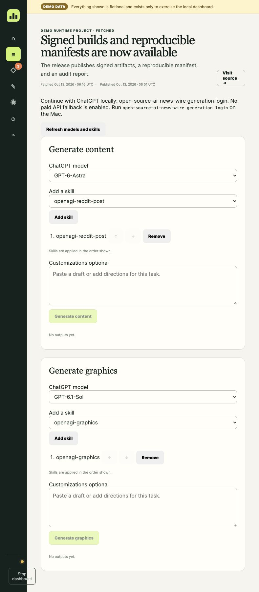
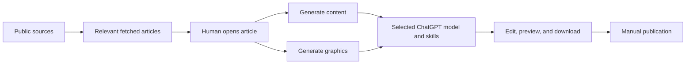

# Open Source AI News Wire

Open Source AI News Wire is a local application for monitoring public AI news and preparing source-linked Reddit content. It collects public, no-login sources and displays every relevant fetched article. Humans choose what to read, generate, and publish.

It covers open-source and open-weight AI, AGI developments, and broader AI news specifically related to privacy, security, and regulation.

The application never publishes editorial content automatically. It can send
informational alerts to one explicitly paired private Telegram team group when
the owner enables that local notification lane; Telegram is not a publishing
destination and does not receive drafts or hosted-dashboard controls.

The owner-only online dashboard lives in [`hosted-dashboard`](hosted-dashboard/README.md).
Its interface is hosted on ChatGPT Sites while the SQLite corpus, collection,
skill-based generation and canonical mutations remain on the laptop. The laptop
makes only signed outbound HTTPS requests and accepts no inbound internet
connection.



## What the product includes

- **Public-source monitoring:** scheduled and on-demand collection from dated public sources.
- **Article inbox:** separate relevant articles, marked Fetched and ordered by first fetch time, with source links and no editorial grading.
- **Operational Review:** source-health, recovery, catch-up, and source-update notices with a separate unread badge.
- **Skill-based generation:** independent Generate content and Generate graphics controls with a ChatGPT model, ordered skills, and optional customizations.
- **Durable outputs:** task progress, input requests, cancellation/retry, saved revisions, and artifact previews/downloads.
- **macOS scheduling and recovery:** scans at minute `00` and `30` while the Mac is awake.
- **Optional private Telegram alerts:** existing informational article alerts remain independent of generation.

The normal workflow is:



## Quick start

Requirements:

- macOS
- Git access to this repository
- [`uv`](https://docs.astral.sh/uv/getting-started/installation/)
- ChatGPT with Codex access only if you want assisted drafting

```bash
git clone https://github.com/SyedShad/open-source-ai-news-wire.git
cd open-source-ai-news-wire
uv python install 3.12.13
uv sync --locked
uv run open-source-ai-news-wire migrate
uv run open-source-ai-news-wire dashboard
```

The dashboard opens on a loopback-only address on your Mac. Use the one-time access link printed by the command if the browser does not open automatically.

To install the half-hour macOS schedule from this checkout:

```bash
uv run open-source-ai-news-wire schedule install \
  --launcher "$PWD/.venv/bin/open-source-ai-news-wire"
uv run open-source-ai-news-wire schedule status
```

See [Getting started](docs/guide/getting-started.md) for the full setup and first review.

## User guide

| Guide | Use it for |
|---|---|
| [Product guide](docs/guide/index.md) | Understand the product, its parts, and its boundaries |
| [Getting started](docs/guide/getting-started.md) | Install, launch, schedule, and verify the application |
| [Features and use cases](docs/guide/features-and-use-cases.md) | See every user-visible capability and when to use it |
| [Everyday workflows](docs/guide/everyday-workflows.md) | Browse articles, select skills, generate, revise, and download |
| [Telegram alerts](docs/guide/telegram-alerts.md) | Pair one private team group and operate local informational alerts |
| [Releases](docs/guide/releases.md) | Check the current version, update, and review release history |

## Current release

The source version is v0.6.0 with database schema 11 and bridge protocol 2.3. Existing installations need an explicit migration. Fetch time stays distinct from publication time.

See the [release guide](docs/guide/releases.md) and [changelog](CHANGELOG.md) for details.

## Important limits

- Collection runs on a schedule; it is not a guaranteed real-time wire service.
- Sources must be public and usable without accounts, cookies, payment, or access bypasses.
- Scheduled work runs while the Mac is awake. A locked screen is fine; sleep pauses work.
- Notifications can arrive after local ingestion, but they cannot detect or send new items while the Mac is asleep, logged out, or offline.
- Telegram alerts are optional, Mac-only, and independent of the hosted dashboard. They include a bold headline, source excerpt when available, linked publisher, and a single Copy link button. No automatic AI inference is used.
- Broader AI News is limited to privacy, security, and regulation; Open Ecosystem and AGI coverage remain separate.
- ChatGPT assistance is optional and can remain unavailable if its local checks fail.
- A human chooses the model and skills for each task, reviews the output, and publishes manually.
- Skills and models come from the local runtime catalog; catalog entries do not guarantee account entitlement or tool availability.
- Generation uses Sign in with ChatGPT plan authorization. No paid API fallback is enabled. Native image-generation and hosted connector tools are currently unavailable on that route; locally rendered graphics are supported.
- Canonical runtime data stays local and has no built-in backup. The hosted
  dashboard retains a redacted read projection, short-lived requested details,
  authentication state, and expiring relay queues.

## Maintainer references

Everyday users should start with the guides above. Maintainer details remain in the [local operator guide](docs/operator-guide.md), [source validation register](docs/source-registry-validation.md), and [security threat model](docs/security-threat-model.md).

## License

MIT. Existing upstream attribution is preserved in repository history and license notices. Inherited Last30Days components remain only where they are deliberately retained and tested.
